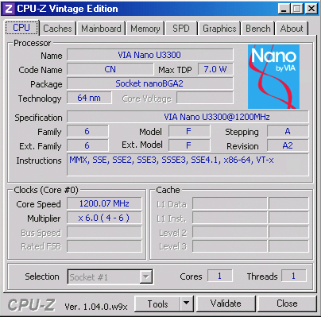
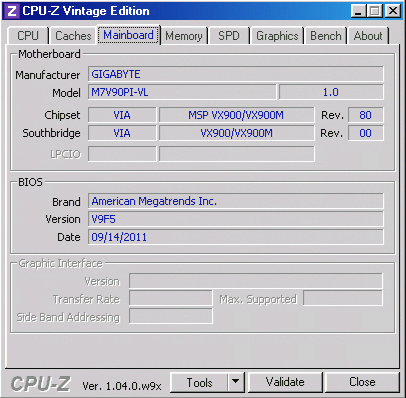
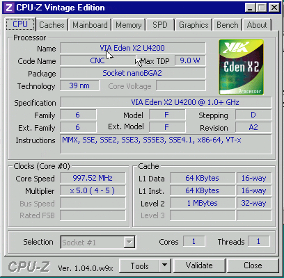
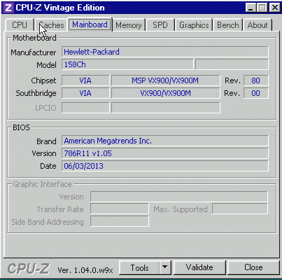

# Windows 95 / 98 / Me boot fix for VIA VX900 boards

Windows 9x freezes at the boot logo on VIA VX900 boards, and locks up when an MS-DOS Prompt is opened. This is a fix for the cause: one patched Windows file, `VDD.VXD`. With it, a stock Windows 98 SE install boots with the logo, completes Setup, and runs DOS windows.

**Support the project:** if this is useful to you, you can [donate through PayPal](https://www.paypal.com/donate/?hosted_button_id=45HAEA4K4KTXU).

## Symptoms this fixes

- Setup copies files, restarts, shows the logo and freezes. Safe mode freezes too.
- With `Logo=0` Windows may start, but opening an MS-DOS Prompt locks the whole machine.
- With the fix only half applied: the logo jumps between resolutions, or a DOS window takes several seconds to open.

## Tested hardware

| Board | CPU | System BIOS | Result |
| --- | --- | --- | --- |
| Gigabyte M7V90PI-VL | VIA Nano U3300 1.2 GHz | AMI V9F5, 09/14/2011 | Windows 98 SE: clean install, logo, DOS windows, full screen |
| HP 158Ch | VIA Eden X2 U4200 1.0 GHz | AMI 786R11 v1.05, 06/03/2013 | Windows 98 SE: logo, DOS windows, full screen |

Graphics on both is the VX900 integrated Chrome9 (PCI `1106:7122`). The fix is in Windows, so it does not depend on the board or the video BIOS version.

Windows 95, 98 and Me use one processor core. On a dual-core chip such as the Eden X2, CPU-Z shows 1 core and 1 thread, as in the screenshots below. That is how these versions of Windows work, not a fault and not something this fix changes.

| | |
| --- | --- |
|  |  |
|  |  |

## Install

### Option 1: ready-made files

`VX9VDD.ZIP` holds a patched `VDD.VXD` for Windows 95 OSR2 (4.00.1111), Windows 98 SE (4.10.2222) and Windows Me (4.90.3000), with an installer.

1. Unzip it and copy the `VX9VDD` folder to the hard disk.
2. Start the computer with **Command prompt only** (F8 at start-up), or from a boot disk on Windows Me.
3. Change into the `VX9VDD` folder and run `INSTALL`. It reads `C:\MSDOS.SYS` to pick the right file. If it cannot tell, run `INSTALL 95`, `INSTALL 98` or `INSTALL ME`.
4. Restart.

Or copy the matching file by hand to `C:\WINDOWS\SYSTEM\VMM32\VDD.VXD`. To remove the fix, run `REMOVE` or delete that file.

Only the Windows 98 SE file has been run on a board. The 95 and Me files carry the same changes.

### Option 2: patch your own file

`VX9VDD.COM` runs under DOS and patches the VDD from your own Windows, including builds not listed above. Boot to **Command prompt only**, then:

```
VX9VDD C:\WINDOWS\SYSTEM\VMM32.VXD VDD.VXD
MD C:\WINDOWS\SYSTEM\VMM32
COPY VDD.VXD C:\WINDOWS\SYSTEM\VMM32
```

The input can be `VMM32.VXD` from an installed Windows 98 or Me (the VDD is taken out of it), or a `VDD.VXD` extracted from the Windows CD. On Windows 95 the `VMM32.VXD` on the CD holds no VDD, so use `VDD.VXD` from the CD or the `VMM32.VXD` of an installed system.

It finds the code by instruction pattern, not by address. If any pattern is missing or appears twice, it stops and leaves no output file. Source is in `VX9VDD.ASM` (NASM).

`vx9vdd.py` does the same job on any computer with Python 3:

```
python vx9vdd.py VMM32.VXD
python vx9vdd.py VDD.VXD OUT.VXD
```

Both tools produce byte-identical output from the same input.

### On a new installation

1. Run Windows Setup normally. It freezes at the logo on the first restart.
2. Reset, boot to **Command prompt only**, and install the fix as above.
3. Restart. Setup continues into hardware detection.

These boards have more RAM than Windows 9x handles on its own. That is a separate problem with its own fixes; the confirmed install used a memory-limit patch as well.

## The cause

The VX900 video BIOS uses registers above the standard VGA set every time it changes screen mode. One of them, sequencer register `5D`, is a timer inside the graphics chip: the BIOS starts it and waits for a bit to come back set, with no time limit.

Windows runs BIOS mode changes inside a virtual machine. Its display driver, the VDD, keeps 16 shadow sequencer registers per virtual machine. For a virtual machine that does not own the hardware it discards writes to higher registers and answers reads with whatever lies past the end of that array. The timer never starts, the bit never reads back set, and the BIOS waits forever.

That happens in three places: two mode changes the VDD makes while it starts, the moment the display driver closes the boot logo, and every time a DOS window opens.

## The four changes

| Change | Effect |
| --- | --- |
| Reads of sequencer registers above `0F` come from the chip | The BIOS sees real values |
| Writes to sequencer register `5D` reach the chip | The chip timer runs, so the BIOS does not wait |
| Extended CRTC writes are held back while Windows sets modes behind the logo | The logo stays steady |
| Port `3C3` is no longer trapped | DOS windows open quickly: the BIOS reads that port about 145,000 times per mode change as a delay |

More detail, including the code at each site, is in [docs/CAUSE.md](docs/CAUSE.md).

## Files

| File | What it is |
| --- | --- |
| `VX9VDD.ZIP` | Patched `VDD.VXD` for 95 OSR2, 98 SE and Me, with `INSTALL.BAT` and `REMOVE.BAT` |
| `VX9VDD.COM`, `VX9VDD.ASM` | The patcher for DOS, and its source |
| `vx9vdd.py` | The same patcher as a Python script |
| `docs/CAUSE.md` | The cause and the changes in detail, and what did not work |
| `extras/` | Diagnostic batch files and an earlier BIOS-side patch, kept for reference |

## Related

The Windows 9x display driver for VIA Chrome9 graphics: https://github.com/360alaska/via-chrome9-win9

## Licence

The patcher, scripts and documentation are MIT licensed, Copyright (c) 2026 360ALASKA. The `VDD.VXD` files inside `VX9VDD.ZIP` are modified copies of Microsoft Windows system files and remain the property of Microsoft.
